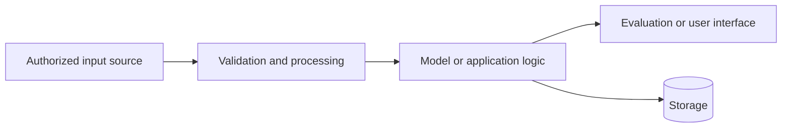

# [Project name]

[One sentence: who faces the problem, and what this project does.]

## Overview

- **Problem:** [Specific user or research question.]
- **My contribution:** [Individual work, collaborators and attribution.]
- **Status:** [Prototype / retrospective research / deployed product.]
- **Evidence:** [Verified report, notebook or live URL. Omit if unavailable.]

## Key features

- [Implemented feature with a reproducible example.]
- [Implemented feature. Separate planned work into Roadmap.]

## System architecture

Replace these nodes with the actual components before publishing.

[Explain data flow, trust boundaries, failure behavior and key trade-offs.]

## Tech stack

| Category | Technology | Why it is used |
| --- | --- | --- |
| Language | [Actual language/version] | [Reason] |
| Framework | [Actual framework/version] | [Reason] |
| Data / infrastructure | [Actual system] | [Reason] |

## Local setup / installation

[State prerequisites. Supply exact tested clone, install, configuration, run and test commands. Do not invent commands. Document required variables in .env.example without real values.]

## Results and limitations

[State only measured results with dataset, period, baseline, split method and reproduction command. Distinguish retrospective results from prospective validation. For trading work, disclose costs, slippage, drawdown and leakage controls. No evidence means no performance claim.]

## Screenshots

[ADD_SCREENSHOT_HERE]

[After adding media, use an image with meaningful alt text describing the actual screen.]

## Roadmap

- [ ] [One concrete next step.]
- [ ] [One evaluation or engineering gap.]

## Data, security and attribution

[Data provenance/license; author and collaborator credits; secrets handling; known access restrictions; actual project license.]
