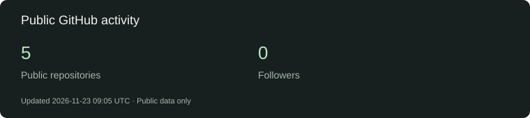

# Karan Kumar
### Quantitative research · Data science · Practical software

Statistics & Data Science and Mathematics at the **University of Arizona**, with a Computer Science minor. Graduating **May 2027**. Based in **Tucson, Arizona**, and open to full-time quantitative research, trading, data science and data analyst opportunities.

I build research projects in statistical arbitrage and prediction, and software that makes complex information easier to use.

[LinkedIn](https://www.linkedin.com/in/karan-kumar-dev1/) · [Email](mailto:karankumar11aa@gmail.com)

## Toolkit

**Languages**  
  

**Modeling & analysis**  
    

**Software & data**  
 

## Selected projects

| Project | Research question or product | Methods / status |
| :--- | :--- | :--- |
| [Gradlae](https://github.com/karankumar-dev1/Gradlae) | AI-assisted degree planning and advising | Next.js, Supabase; planner, transcript and advisor workflows |
| Statistical arbitrage pairs engine | Relative-value signals in paired assets | Python; historical backtesting; source not published |
| Bitcoin prediction model | Prediction under changing market regimes | XGBoost, hidden Markov models; historical backtesting; source not published |
| NFL game prediction | Game-outcome prediction | Class research project; source not published |

Backtests are historical research, not live-performance claims. Evaluation periods, transaction costs and validation methods should accompany any published performance figure. No public demos are currently linked.

## Background

- **University of Arizona**: Statistics & Data Science and Mathematics double major, Computer Science minor. Expected May 2027.
- **Horizon Software**: ETL internship focused on data workflows.
- **UA Think Tank**: tutoring more than 500 students a year.

## GitHub activity

This repository generates and stores its own activity image with GitHub Actions. It summarizes public activity only, not research quality or private work.

---
[LinkedIn](https://www.linkedin.com/in/karan-kumar-dev1/) · [karankumar11aa@gmail.com](mailto:karankumar11aa@gmail.com)
